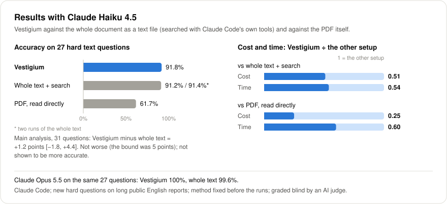
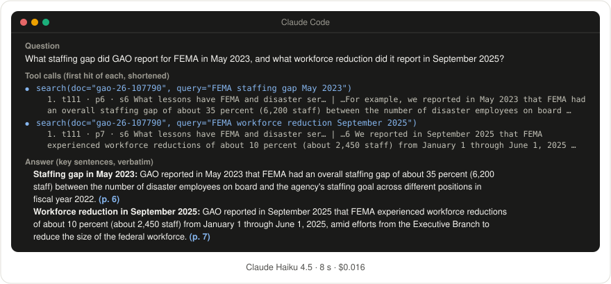
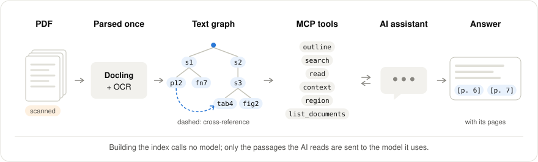

# Vestigium

**Every answer leaves a trace back to its page.**

Vestigium lets an AI agent read long, messy PDFs (annual reports, regulations, technical manuals, scanned archives) the way a careful analyst would: check the table of contents, turn to the right section, quote the original words, and note the page.

[中文说明](README_ZH.md)

Measured inside Claude Code, on new hard questions about long English public reports, with the test method fixed before the runs:

- **Claude Haiku: no worse than giving it the whole document, at about half the cost and time.** Accuracy **+1.2 points** [−1.8, +4.4] against the whole text searched with Claude Code's own tools, within the 5-point bound set in advance; cost **0.51**, time **0.54**.
- **Claude Haiku: 21 points more accurate than reading the PDF, at about a quarter of the cost.** **+21.2 points** [+12.3, +30.8]; cost **0.25**; **no made-up facts** (6 with the PDF).
- **Claude Opus: 100% on 27 hard questions** with Vestigium, and 99.6% with the whole text. Both are at the ceiling.



Answers were graded blind by an AI judge; a human spot check has not been done yet.

## Why it's different

- **A map, not a pile of chunks.** Docling parses the PDF, with OCR for scanned pages. Vestigium then organizes sections, PDF and printed page numbers, tables, figures, footnotes, cross-references and defined terms, and gives each piece an address such as `s12`, `p45`, `tab4`, `P36` or `AC-2(3)`. The agent reads by address.
- **Answers you can check.** Every passage the agent reads carries its PDF page, so each fact in an answer can point back to it.
- **Tested fairly, with the method fixed in advance.** We measured Vestigium inside a real agent app, against strong baselines; wrote the method down before the runs; used new questions the system had never seen; graded blind; and had the results recomputed independently. See [Methods](docs/METHODS.md).
- **Light and local.** No vector database, no embeddings, and no model calls to build the index. Everything runs on your machine; only the passages your agent reads are sent to the model it uses.
- **Small models at about half the cost.** With Vestigium, the small Claude Haiku did no worse than with the whole text on hard questions, at about half the cost and time, and was far more accurate than reading the PDF.
- **Also:** experimental Chinese support, a plain-file export for apps without MCP, pictures of figures and tables when text is not enough, and exact-text search that counts every match.

Other projects also navigate long documents through trees or hierarchies, and some of them also run locally, build their index without model calls or point to pages; see [Similar projects](docs/RELATED.md). We have not compared Vestigium with them on the same questions.

## See it work

A real run from our pre-release check: Claude Haiku 4.5 in Claude Code, asking about the sample document that ships with Vestigium (a 10-page GAO report). The run was made before the project got its current name, with the same tools.

**Question:** What staffing gap did GAO report for FEMA in May 2023, and what workforce reduction did it report in September 2025?



<details>
<summary>Text version</summary>

**What the agent did:** two searches, then it answered. Below is the first hit of each search, shortened.

```
search(doc="gao-26-107790", query="FEMA staffing gap May 2023")
  1. t111 · p6 · s6 What lessons have FEMA and disaster ser… | …For example, we reported in May 2023 that FEMA had
     an overall staffing gap of about 35 percent (6,200 staff) between the number of disaster employees on board …
search(doc="gao-26-107790", query="FEMA workforce reduction September 2025")
  1. t111 · p7 · s6 What lessons have FEMA and disaster ser… | …6 We reported in September 2025 that FEMA experienced
     workforce reductions of about 10 percent (about 2,450 staff) from January 1 through June 1, 2025 …
```

**Answer** (key sentences, verbatim):

> **Staffing gap in May 2023:** GAO reported in May 2023 that FEMA had an overall staffing gap of about 35 percent (6,200 staff) between the number of disaster employees on board and the agency's staffing goal across different positions in fiscal year 2022. (p. 6)
>
> **Workforce reduction in September 2025:** GAO reported in September 2025 that FEMA experienced workforce reductions of about 10 percent (about 2,450 staff) from January 1 through June 1, 2025, amid efforts from the Executive Branch to reduce the size of the federal workforce. (p. 7)

</details>

2 tool calls, 8 seconds, $0.016 at list price. Both facts match the PDF.

## Results

With Claude Haiku 4.5:

| Vestigium compared with | Accuracy, Vestigium minus the other [95% interval] | Cost, Vestigium ÷ the other | Time, Vestigium ÷ the other |
|---|---|---|---|
| The whole document as a text file, searched with Claude Code's own tools | **+1.2 points** [−1.8, +4.4]: not worse (the bound was 5 points) | **0.51** | **0.54** |
| The PDF itself, read page by page | **+21.2 points** [+12.3, +30.8] | **0.25** | 0.60 |

- **Made-up facts**: none with Vestigium or with the text file; with the PDF, the judge marked 6 answer points as made up.
- **Larger model** (Claude Opus 5.5): 100% with Vestigium and 99.6% with the text file on 27 hard questions. Both are at the ceiling, so this test cannot tell them apart. Vestigium cost 0.80 of the text file.
- **This release** adds features on top of the tested version. On 65 development questions with Haiku it showed no regression: 97.2% against 97.1%, at 0.92 of the cost. The difference is too small to call it better.

| You want | Use | In our test |
|---|---|---|
| Accuracy first | Claude Opus + Vestigium | Near the ceiling on 27 hard questions. Opus with the whole text scored 99.6%, so this test cannot tell the two apart |
| Low cost | Claude Haiku + Vestigium | About 92% on the same questions, about 6.5 US cents per question at list price |

**How you pay matters.** The savings are in tokens at list price. If you pay per token (for example, an API key), they turn into money saved. If your plan charges per request or per message, using fewer tokens may not lower your bill; with Haiku, Vestigium still finishes in about half the time of the whole-text setup. We have not measured per-request plans.

Details: [Results](docs/RESULTS.md), [Methods](docs/METHODS.md).

## What this does not show

- That Vestigium is more accurate than giving the model the whole text: only that it is not worse by more than 5 points.
- That it works in other agent apps. Only Claude Code was tested; a GPT model used the tools without errors on 5 questions, which says nothing about its accuracy.
- That it works for languages other than English. Chinese is supported as experimental: on 15 easier Chinese questions, the three rules fixed in advance (no more than 5 points below the whole Chinese text, no made-up facts, no higher cost) were all met ([details](docs/RESULTS.md#chinese-experimental)).
- That small models read charts well: on questions that need a figure, Haiku with Vestigium scored 33%.
- That the AI judge agrees with people: the human spot check is still to come.

Also, the quality of a new PDF depends on how well Docling parses it; check the quality report written at ingest. More in [Limits and FAQ](docs/FAQ.md).

## Quick start

```bash
# 1. Install (Python 3.12 or later)
pip install "vestigium[ingest] @ git+https://github.com/Yonagi043/vestigium"

# 2. Process your PDF (stored in ~/.vestigium by default; set VESTIGIUM_HOME to change)
vestigium ingest path/to/report.pdf

# 3. Connect it to Claude Code
claude mcp add --transport stdio vestigium -- vestigium mcp
```

4. Start `claude` and ask, for example: *"Using the vestigium tools, what are the main findings of `report`? Cite the PDF pages."*

Step by step, with the sample PDF and checks: [Quick start](docs/QUICKSTART.md).

## How it works



- **Search, then read by address.** The agent does not load the whole document. It searches, reads the sections or pages it needs, and asks for context (the section path, what refers to this passage, the terms it uses) when it must check scope or conditions.
- **Pages you can check.** Every passage carries its PDF page; printed page numbers are shown next to them when they differ.
- **Size limits built in.** Each reply is capped so that Claude Code shows it in full instead of moving it to a file. Other apps have lower limits; see [Agent apps](docs/CLIENTS.md).
- **Plain search.** Search is keyword-based (BM25), with no embeddings and no vector database.

## Tools

| Tool | What it does |
|---|---|
| `list_documents` | List the documents you have processed |
| `outline` | Table of contents: section addresses, titles, pages, sizes |
| `search` | Find passages; `mode="literal"` counts exact matches |
| `read` | Read several addresses at once: `s12`, `p45-47`, `tab4`, `P36` (printed page), `Note 7`, `AC-2(3)` … |
| `context` | Section path, parent and sibling sections, references in and out, terms, footnotes |
| `region` | Picture of a table, figure or page area, with its text layer |

Full reference, address forms and switches: [Tools](docs/TOOLS.md).

## Agent apps

- **Claude Code**: tested over local stdio. A long-running HTTP mode is new in this release; it connects, but was not used in our answer tests.
- **VS Code (Copilot), Cursor and other MCP clients**: configuration examples are provided. By the protocol they should connect, but we have not tested them.
- **No MCP?** Apps whose agent can read files can use a plain-file export instead. We have tested this only in Claude Code: it passed a small check fixed in advance, so where MCP is not available we recommend it instead of a single whole-text file. It costs about twice as much as using MCP.

See [Agent apps](docs/CLIENTS.md).

## Documentation

| Page | Contents |
|---|---|
| [Quick start](docs/QUICKSTART.md) | Install, process a PDF, connect, first question |
| [Agent apps](docs/CLIENTS.md) | Claude Code, VS Code, Cursor, HTTP mode, file export |
| [Tools](docs/TOOLS.md) | The six tools, addresses, allowlist, switches |
| [Results](docs/RESULTS.md) | What we measured and what it shows |
| [Methods](docs/METHODS.md) | How the comparison was kept fair, and how to reproduce it |
| [Similar projects](docs/RELATED.md) | Tree-navigation and hierarchical-retrieval work |
| [Limits and FAQ](docs/FAQ.md) | Known weaknesses and common questions |

## The name

Latin *vestigium* means a footprint or trace. The English word *investigate* goes back to it, through Latin *investigare*, "to follow a track".

## License

The code is under MIT; see [LICENSE](LICENSE). The questions and answer keys in `benchmark/` are under CC BY 4.0; see [benchmark/LICENSE](benchmark/LICENSE).
