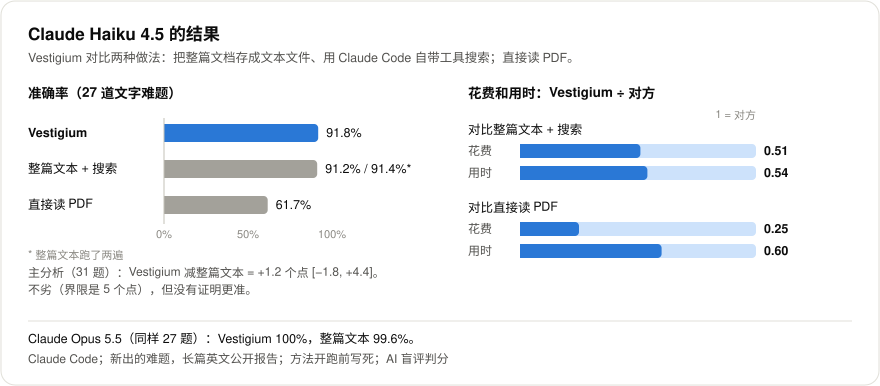
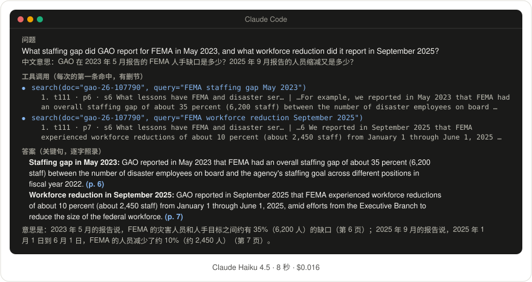
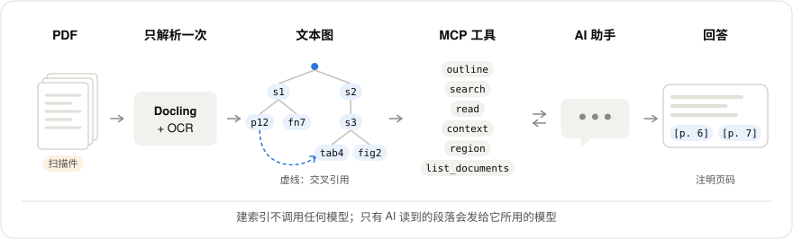

# Vestigium（迹）

**每个回答，有迹可循。**

Vestigium（迹）让 AI 助手像细心的分析师一样读又长又乱的 PDF（年报、法规、技术手册、扫描档案）：先看目录，翻到对的那一节，摘出原话，标上页码。

[English](README.md)

> **0.1.1 新增**
> - **少停早了**（默认开）：一节接到下一页还没完时，Vestigium 把下一页一起送上，AI 助手读一半就停的情况少了。
> - **看得见是怎么读的**（可选）：每次阅读都记在你自己的机器上（设 `TGLW_TRACE=0` 可关掉）；打开 `trace` 工具，就能问 AI 助手上次是怎么读的。
> - **告诉它以后怎么读**（可选）：打开 `rules` 工具，AI 助手可以写规则，由 Vestigium 自己执行；随时能撤销、恢复出厂。
> - **仍然在本地**：什么都不上传。
>
> 实测结果（每次运行有波动）：准确率不比 0.1.0 差；花费平均低约 3%、用时平均短约 5%，都在波动范围内。详见[结果：0.1.1](docs/RESULTS_0_1_1_ZH.md)。

用 0.1.0 版在 Claude Code 里实测：题目是新出的难题，材料是英文的长篇公开报告，检验方法在开跑前就写死了。

- **Claude Haiku：准确率不比“把整篇全文交给模型”差，花费和用时都约一半。** 准确率 **+1.2 个点** [−1.8, +4.4]（对照组是整篇文本加 Claude Code 自带的搜索），在事先定的 5 个点界限之内；花费 **0.51**，用时 **0.54**。
- **Claude Haiku：比直接读 PDF 准 21 个点，花费约四分之一。** **+21.2 个点** [+12.3, +30.8]；花费 **0.25**；**没有编造**（读 PDF 的那组编造了 6 处）。
- **Claude Opus：27 道难题拿到 100%**；用整篇全文是 99.6%。两者都到顶了。



答案由 AI 盲评判分，人工抽检还没做。

## 为什么不一样

- **一张地图，而不是一堆碎块。** Docling 解析 PDF，扫描页走 OCR。Vestigium 再整理出章节、PDF 页码和印刷页码、表格、图、脚注、交叉引用、术语定义，每一块都有地址，比如 `s12`、`p45`、`tab4`、`P36`、`AC-2(3)`。AI 助手直接按地址读。
- **回答可以核对。** 助手读到的每段话都带 PDF 页码，答案里的每个事实都能指回原处。
- **测法公平，方法事先写死。** 我们在真实的 AI 外壳里测 Vestigium，和强的对照组比；开跑前先写好方法；用系统没见过的新题；盲评判分；结果由另一个代理独立复算。见[方法](docs/METHODS_ZH.md)。
- **轻，在本地。** 不用向量库，不用嵌入，建索引不调模型。一切在你自己的机器上运行；只有 AI 助手读到的段落，会发给它所用的模型。
- **小模型也够用，花费约减半。** 小模型 Claude Haiku 用 Vestigium，在难题上不比给整篇文本差，花费和用时约一半，比直接读 PDF 准得多。
- **另外还有：** 实验性的中文支持；没有 MCP 时可以导出成普通文件；文字不够用时可以截图看图表；字面检索能数出全部命中。

也有别的项目用树形结构或分层检索读长文档，其中有的也在本地运行、建索引不调模型或者指向页码，见[同类项目](docs/RELATED_ZH.md)。我们没有在同一批题上和它们比过。

## 看它怎么用

这是发布前检查里的一次真实运行：在 Claude Code 里用 Claude Haiku 4.5，问随 Vestigium 一起发布的样例文档（一份 10 页的 GAO 报告）。那次是在项目改成现在这个名字之前跑的，工具是同一套。

**问题**（原文是英文，下面是中文意思）：GAO 在 2023 年 5 月报告的 FEMA 人手缺口是多少？2025 年 9 月报告的人员缩减又是多少？



<details>
<summary>文字版</summary>

**助手做了什么**：搜了两次，然后作答。下面是每次搜索的第一条命中，有删节。

```
search(doc="gao-26-107790", query="FEMA staffing gap May 2023")
  1. t111 · p6 · s6 What lessons have FEMA and disaster ser… | …For example, we reported in May 2023 that FEMA had
     an overall staffing gap of about 35 percent (6,200 staff) between the number of disaster employees on board …
search(doc="gao-26-107790", query="FEMA workforce reduction September 2025")
  1. t111 · p7 · s6 What lessons have FEMA and disaster ser… | …6 We reported in September 2025 that FEMA experienced
     workforce reductions of about 10 percent (about 2,450 staff) from January 1 through June 1, 2025 …
```

**答案**（关键句，逐字照录）：

> **Staffing gap in May 2023:** GAO reported in May 2023 that FEMA had an overall staffing gap of about 35 percent (6,200 staff) between the number of disaster employees on board and the agency's staffing goal across different positions in fiscal year 2022. (p. 6)
>
> **Workforce reduction in September 2025:** GAO reported in September 2025 that FEMA experienced workforce reductions of about 10 percent (about 2,450 staff) from January 1 through June 1, 2025, amid efforts from the Executive Branch to reduce the size of the federal workforce. (p. 7)

意思是：2023 年 5 月的报告说，FEMA 的灾害人员和人手目标之间约有 35%（6,200 人）的缺口（第 6 页）；2025 年 9 月的报告说，2025 年 1 月 1 日到 6 月 1 日，FEMA 的人员减少了约 10%（约 2,450 人）（第 7 页）。

</details>

调用工具 2 次，用时 8 秒，按标价花费 $0.016。两个事实都和 PDF 原文一致。

## 结果

用 Claude Haiku 4.5 时：

| Vestigium 和谁比 | 准确率：Vestigium 减对方 [95% 区间] | 花费：Vestigium ÷ 对方 | 用时：Vestigium ÷ 对方 |
|---|---|---|---|
| 把整篇文档存成文本文件，用 Claude Code 自带的工具搜索和读取 | **+1.2 个点** [−1.8, +4.4]：不比它差（事先定的界限是 5 个点） | **0.51** | **0.54** |
| 直接读 PDF，一页页看 | **+21.2 个点** [+12.3, +30.8] | **0.25** | 0.60 |

- **编造**：用 Vestigium 和用文本文件都没有；直接读 PDF 时，判分认定有 6 个要点是编的。
- **大模型**（Claude Opus 5.5）：27 道难题上，用 Vestigium 100%，用文本文件 99.6%。两者都到顶了，这次测试分不出高低。花费是文本文件的 0.80。
- **0.1.0 发布版**：在实测版本上又加了一些功能。在 65 道开发题上用 Haiku 检查，没有退步：97.2% 对 97.1%，花费是实测版本的 0.92。差距太小，不能说发布版更好。

| 你要 | 用 | 这次测试里 |
|---|---|---|
| 要准 | Claude Opus + Vestigium | 27 道难题上接近满分。Opus 用整篇文本也有 99.6%，这次测试分不出两者高低 |
| 要省 | Claude Haiku + Vestigium | 同样的题约 92%，按标价每题约 6.5 美分 |

**计费方式会影响“省”。** 这里的“省”是按标价算的 token 花费。按 token 计费（比如用 API 密钥）时，省下的 token 就是省下的钱。如果你的套餐按请求次数或消息条数计费，少用 token 不一定少花钱；不过用 Haiku 时，和整篇文本相比，用时仍然约减半。按请求计费的情况我们没有实测。

详见[结果](docs/RESULTS_ZH.md)、[方法](docs/METHODS_ZH.md)。

## 还不能说明的

- Vestigium 比把整篇文本交给模型更准：只能说明不比它差 5 个点以上。
- 它在别的 AI 外壳里也能用：只测了 Claude Code；一个 GPT 模型在 5 道题上用这些工具没有出错，但这说明不了它有多准。
- 它支持英文以外的语言：中文是实验性支持：在 15 道偏容易的中文题上，事先定的三条规则（不比整篇中文全文低 5 个点以上、不编造、不更贵）都满足（[详情](docs/RESULTS_ZH.md#中文实验性)）。
- 小模型能读准图表：要看图的题上，Haiku 用 Vestigium 只答对 33%。
- AI 判分和人的判断一致：人工抽检还没做。

另外，新 PDF 处理得好不好，取决于 Docling 解析得好不好；入库时会生成质检报告，请看一眼。更多见[局限和常见问题](docs/FAQ_ZH.md)。

## 快速上手

```bash
# 1. 安装（需要 Python 3.12 或更新）
pip install "vestigium[ingest] @ git+https://github.com/Yonagi043/vestigium"

# 2. 处理你的 PDF（默认存在 ~/.vestigium；用 VESTIGIUM_HOME 换位置）
vestigium ingest path/to/report.pdf

# 3. 接进 Claude Code
claude mcp add --transport stdio vestigium -- vestigium mcp
```

4. 启动 `claude`，问一个问题，比如：*"Using the vestigium tools, what are the main findings of `report`? Cite the PDF pages."*（意思是：用 vestigium 的工具读 `report`，它的主要结论是什么？请写出 PDF 页码。用中文问英文文档，我们没有测过。）

带样例 PDF 和检查步骤的完整版：[快速上手](docs/QUICKSTART_ZH.md)。

## 怎么做到的



- **先搜，再按地址读。** 助手不用把整份文档读进来。它先搜索，再读需要的节或页；要核对适用范围和条件时，用 `context` 看章节路径、哪些地方引用了这段、用到了哪些术语。
- **页码能核对。** 每段内容都带 PDF 页码；印刷页码不同时，一并标出。
- **输出有上限。** 每次返回都控制了大小，让 Claude Code 完整显示，而不是转存成文件。别的外壳上限更低，见[各客户端的接法](docs/CLIENTS_ZH.md)。
- **搜索简单。** 搜索按关键词（BM25），不用向量，也不用向量数据库。

## 工具

| 工具 | 做什么 |
|---|---|
| `list_documents` | 列出你处理过的文档 |
| `outline` | 目录：节的地址、标题、页码、大小 |
| `search` | 找段落；`mode="literal"` 按原文精确匹配并计数 |
| `read` | 一次读多个地址：`s12`、`p45-47`、`tab4`、`P36`（印刷页码）、`Note 7`、`AC-2(3)` …… |
| `context` | 章节路径、上级节和同级节、引用出去和引用进来、术语、脚注 |
| `region` | 把表格、图或页面上的一块截成图片，附文字层 |

完整说明、地址写法和开关：[工具说明](docs/TOOLS_ZH.md)。

0.1.1 加了两个可选的工具，默认关：

| 工具 | 做什么 | 怎么打开 |
|---|---|---|
| `trace` | 用[阅读语言](docs/LANGUAGE_ZH.md)一步步写出以前的阅读是怎么走的 | `TGLW_TRACE_TOOL=1` |
| `rules` | 列出、增加、修改、预演、撤销由工具自己执行的[规则](docs/RULES_ZH.md)；恢复出厂或全部关掉 | `TGLW_RULES_TOOL=1` |

接入服务时把开关传进去，比如 `claude mcp add --env TGLW_TRACE_TOOL=1 --env TGLW_RULES_TOOL=1 --transport stdio vestigium -- vestigium mcp`。如果以前用 `--scope user` 加过，先运行 `claude mcp remove --scope user vestigium`，再带上开关和 `--scope user` 重新加。

## 能接哪些 AI 外壳

- **Claude Code**：用本地 stdio 实测过。常驻的 HTTP 模式是 0.1.0 加的，能连上，但没有在答题测试里用过。
- **VS Code（Copilot）、Cursor 和其他 MCP 客户端**：给了配置示例。按协议应该能连上，但我们没有实测。
- **外壳不支持 MCP？** 能读文件的外壳可以改用导出的文件版。我们只在 Claude Code 里测过：它通过了事先定的小检查，所以没有 MCP 时，推荐用它代替单个整篇文本文件。它的花费约是通过 MCP 的两倍。

见[各客户端的接法](docs/CLIENTS_ZH.md)。

## 文档

| 页面 | 内容 |
|---|---|
| [快速上手](docs/QUICKSTART_ZH.md) | 安装、处理 PDF、接入、第一个问题 |
| [各客户端的接法](docs/CLIENTS_ZH.md) | Claude Code、VS Code、Cursor、HTTP 模式、文件版导出 |
| [工具说明](docs/TOOLS_ZH.md) | 6 个工具、地址写法、白名单、开关 |
| [结果](docs/RESULTS_ZH.md) | 测了什么，说明了什么 |
| [结果：0.1.1](docs/RESULTS_0_1_1_ZH.md) | 0.1.1 有什么变化，附数字 |
| [方法](docs/METHODS_ZH.md) | 怎么保证公平，怎么复现 |
| [同类项目](docs/RELATED_ZH.md) | 树形导航和分层检索的相关工作 |
| [局限和常见问题](docs/FAQ_ZH.md) | 已知弱点和常见问题 |
| [阅读语言](docs/LANGUAGE_ZH.md) | 记轨迹、写规则用的那门小语言 |
| [轨迹](docs/TRACES_ZH.md) | 一份文档是怎么读的：怎么问 AI 助手，存了什么 |
| [规则](docs/RULES_ZH.md) | 以后该怎么读：写规则、预演、撤销、恢复出厂、全部关掉 |

## 名字

拉丁文 vestigium 的意思是“足迹、痕迹”。英文的 investigate（调查）就源自它，经由拉丁文 investigare，“循着足迹去找”。

## 许可证

代码用 MIT 许可证，见 [LICENSE](LICENSE)。`benchmark/` 里的题目和答案键用 CC BY 4.0，见 [benchmark/LICENSE](benchmark/LICENSE)。
